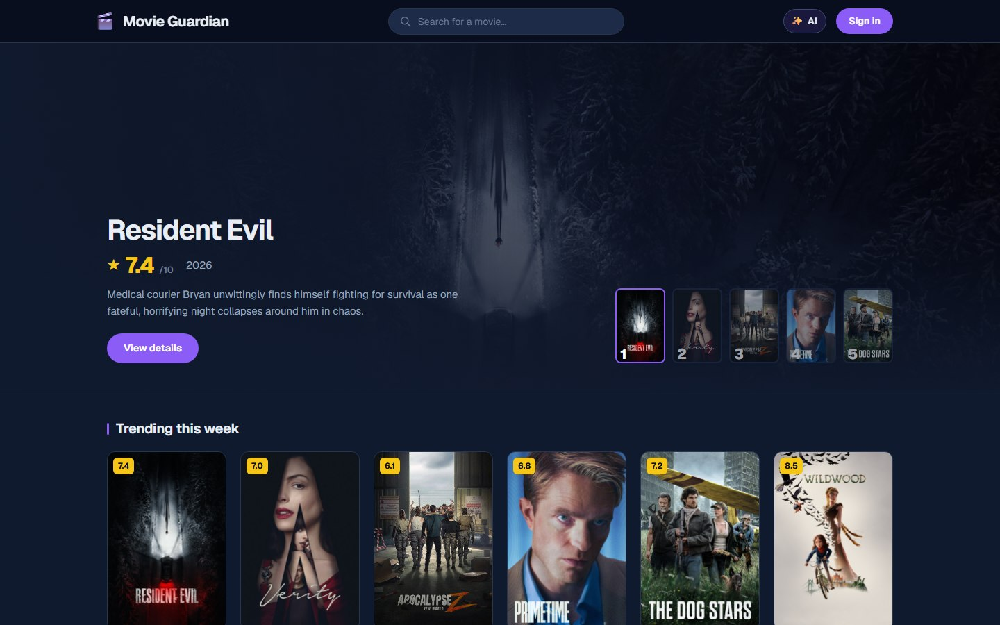

# Movie Guardian

A movie tracker for me and a few close friends, with a chat assistant that reads what you have watched and how you rated it before it recommends anything.

Live at <https://movie-guardian.vercel.app>



## Why I built this

My friends and I keep track of what we watch on IMDb and Letterboxd. Both are good at keeping the list. Neither is good at telling me what to watch next: the suggestions are mostly whatever is popular, or something loosely related by genre.

I wanted recommendations that start from my own history: the films I rated 9, the ones I rated 3, and what is already on my watchlist. So I built a site that keeps that history and puts an assistant on top of it.

## What it does

- **Search** any film from TMDB, with suggestions as you type.
- **Film pages** with the backdrop, TMDB score, genres, top cast, a click-to-play trailer and an "If you liked this" row.
- **Seen, Watchlist and a 1–10 rating** on every film. Every poster on the site then shows a green line (seen) or a gold line (watchlist), and films you have seen are dimmed so the unwatched ones stand out.
- **My Movies**: everything you have marked, with counts, your average rating, Seen and Watchlist tabs, and sorting.
- **The movie assistant**: a chat panel in the nav bar. Before each conversation it reads your seen list, your ratings and your watchlist, so a question like "something like Arrival, but lighter" is answered against your taste, and it does not suggest films you have already seen. Every film it names links to that film's page on the site.
- **Accounts** with email and password. Sign-up is confirmed with an 8-digit emailed code, and there is a forgot-password flow and a change-password page.

## How the movie assistant works

```text
browser                        /api/chat (server)                 Vercel AI Gateway
-------                        ------------------                 -----------------
the chat so far     ------>    1. who are you? (Supabase)
+ your access token            2. read your seen / rated / watchlist rows
                               3. turn them into a short paragraph
                               4. ask the model, streaming ------> a free model
words appear        <------    5. turn **film titles** into links  <------
```

- **The server decides who you are, not the browser.** The page sends its Supabase access token, and the database's Row Level Security rules mean the route can only ever read your own rows.
- **Your history becomes a short paragraph** ("Loved: Arrival 9/10, Heat 9/10. Rated lowest: Cats 2/10. Watchlist: Dune") placed in front of the conversation. That paragraph is what makes the answers personal.
- **One request to the model per question.** The free tier allows about five requests a minute for the whole account, so this is the number the design is built around. Answers stream in word by word.
- **Titles are checked against TMDB, not trusted.** The model writes film titles in bold; the server looks each one up and turns it into a link. A wrong year gets corrected, and a film that does not exist stays unlinked.
- **Facts are fetched before the model answers** for the film page you opened the chat from and for films already linked in the conversation: cast with character names, year, runtime, director.

The full reasoning, including an audit where I put ten trap questions to the live model and checked every answer against TMDB, is in [docs/DEVELOPMENT.md](docs/DEVELOPMENT.md#the-movie-assistant-ai-chat).

## Built with

| Part                                                   | Used for                                                    |
| ------------------------------------------------------ | ----------------------------------------------------------- |
| Next.js 16 (App Router), TypeScript, plain CSS         | The site itself                                             |
| Supabase                                               | Accounts and the Postgres database, with Row Level Security |
| TMDB API                                               | Film data, posters and trailers                             |
| Vercel                                                 | Hosting, deployed from `main`                               |
| Vercel AI Gateway with the `openai` SDK                | The movie assistant, on a free model                        |
| Vitest, React Testing Library, ESLint, Prettier, Husky | Tests and checks, run before every commit and in CI         |

## Running it locally

These are the steps I use on my own machines. Read the [License](#license) section before using the code for anything else.

You need Node.js 24, a free TMDB account, a Supabase project, and optionally a Vercel AI Gateway key (without it the site works and the chat panel says the assistant is switched off).

```bash
git clone https://github.com/tudorbaranai/movie-guardian.git
cd movie-guardian
npm install
cp .env.example .env.local   # then fill in the values
npm run dev
```

Then open <http://localhost:3000>. The SQL for the `user_movies` table and its security rules, and the Supabase auth settings, are in [docs/DEVELOPMENT.md](docs/DEVELOPMENT.md#database-and-auth-supabase).

`npm run check` runs formatting, lint, the type check and the 180 unit tests in one go.

## Known limitations

- **Anyone can create an account.** Sign-up on the live site is open. The assistant needs a signed-in user and is limited to 20 messages an hour per person, but there is no invite list.
- **The assistant runs on a small free model.** When the shared limit of about five requests a minute is hit, the chat waits and retries for up to about half a minute, then asks you to try again in a minute. It can still get a detail wrong with confidence; an unlinked bold title is the hint that it may have made a film up.
- **It does not look up whatever you ask about.** Facts are fetched only for the film page you opened the chat from and for films already linked in the conversation. Typing a name into the question does not trigger a lookup.
- **Chats are not saved.** Reloading the page clears the conversation.
- **The recommender of my own is not built yet.** Today's recommendations come from the assistant. "Similar movies" from film embeddings and a "Recommended for you" list are planned (Phases 2 and 3 in [PLAN.md](PLAN.md)), as are the friends features: seeing what friends watched and shared watchlists.
- **Made for a handful of users.** Sign-up and password emails go through a Gmail account, which has a daily sending limit and can land in spam.

## What's in this repo

| Path                          | What it is                                                            |
| ----------------------------- | --------------------------------------------------------------------- |
| `app/`                        | Pages and the two API routes (`/api/search`, `/api/chat`)             |
| `components/`                 | Shared pieces: header, poster card, grids, search bar, the chat panel |
| `lib/`                        | TMDB and Supabase clients, and the assistant's logic                  |
| `__tests__/`                  | Unit tests, in the same folders as the code they test                 |
| `scripts/probe-assistant.mjs` | `npm run probe`: the ten trap questions, against the live model       |
| `docs/DEVELOPMENT.md`         | Setup, environment variables, database, and how the assistant works   |
| `PLAN.md`                     | Roadmap and design decisions                                          |
| `.env.example`                | The environment variables the app needs, without values               |

## How it came together

- **July 2026.** Started from Create Next App on Windows. Search, film pages, Supabase login, Seen/Watchlist/ratings, My Movies, the dark theme, live search suggestions and the poster markers.
- **14 September 2026.** Moved development to a MacBook, upgraded to Next.js 16.3.5 for security fixes, and deployed on Vercel.
- **15 September 2026.** Sign-up confirmed with an emailed code, password confirmation, forgot and change password, a QA pass, and the test suite with a pre-commit hook.
- **18 September 2026.** The movie assistant, running on a free model.
- **22–28 September 2026.** Caught the assistant stating things that were not true, put it through ten trap questions checked against TMDB, and rewrote its rules and the way it links films.
- **November 2026.** Got the repository ready to be public: this README, a license and CI.

I built this with Claude Code as a pair programmer; the decisions, wiring and testing are mine.

## Credits

Film data, posters and trailers come from [TMDB](https://www.themoviedb.org/). This product uses the TMDB API but is not endorsed or certified by TMDB.

## License

All rights reserved. The code is public so it can be read, not reused; see [LICENSE](LICENSE). This is a personal project and I am not taking contributions.
